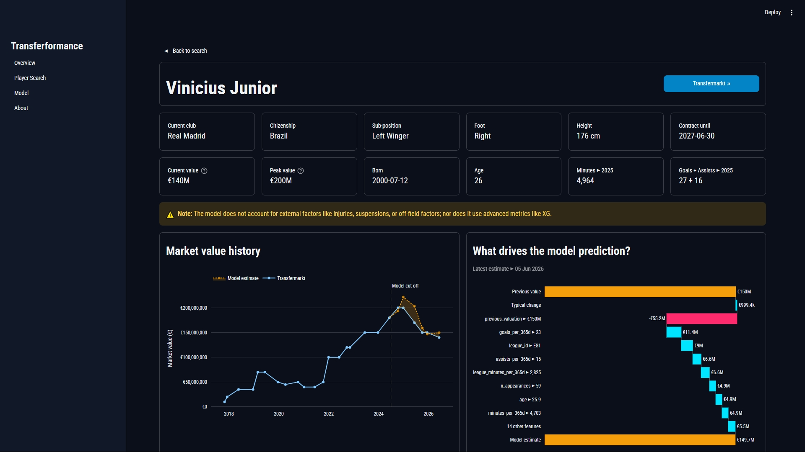

# Transferformance

An interactive Streamlit app for exploring Transfermarkt player valuations and transfer histories, powered by a dual-model LightGBM pipeline that handles both established and newly valued players to predict future market value.



## Features

- **Market Overview:** Headline dataset metrics, top-valued players, valuation distributions by position and competition, and actual-vs-predicted calibration plots.
- **Fuzzy Player Search:** Typo-tolerant lookup *(e.g., "jud bellham" → "Jude Bellingham")* with multi-attribute filtering by valuation range, position, nationality, and club.
- **Player Deep-Dive:** Historical valuation trajectories, post-cutoff single-step estimates, SHAP waterfall breakdowns explaining individual predictions, and transfer history alongside model estimates. Shareable via `/player?player=<id>`.
- **Model Diagnostics:** Validation/test benchmarks, hyperparameter configuration, and test-set residual analysis.

## Architecture & Setup

The project separates offline data engineering and batch inference from the frontend. The Streamlit app reads pre-computed Parquet tables directly instead of querying the raw DuckDB store.

Environment and dependencies are managed with [uv](https://docs.astral.sh/uv/).

### Quickstart
Clones the repository, installs dependencies, runs the ETL pipeline, and launches the dashboard (run outside an existing clone):

```bash
./run_pipeline.sh     # Linux / macOS
.\run_pipeline.ps1    # Windows (PowerShell)

```

### Step-by-Step Execution

```bash
# 0. Setup the environment
git clone https://github.com/nqthinh04/transferformance.git
cd transferformance
uv sync

# 1. Ingestion & feature engineering
uv run python -m transferformance.raw.download
uv run python -m transferformance.interim.build
uv run python -m transferformance.processed.build --hist

# 2. Serving layer & batch inference
uv run python -m transferformance.serving.build_from_database
uv run python -m transferformance.serving.build_from_model

# 3. Launch app
uv run streamlit run ./src/app/main.py

```

### Dashboard Only

For subsequent runs, simply restart the app anytime with

```bash
./run_dashboard.sh        # or .\run_dashboard.ps1
```

Additional flags pass directly to Streamlit (e.g., `--server.port 8502`).


## Data Source & Attribution

The main data source is [transfermarkt-datasets](https://github.com/dcaribou/transfermarkt-datasets), created and maintained by [David Cereijo](https://github.com/dcaribou). This dataset collects and processes publicly available data from [Transfermarkt](https://www.transfermarkt.co.uk/) and is distributed under the Creative Commons CC0 1.0 Public Domain Dedication. This project uses the `.duckdb` version of the dataset, which is populated via an automated data pipeline and hosted on Cloudflare R2.

> ⚠️ **Note:** Updates to the upstream dataset pipeline are currently paused. The data is current as of July 6, 2026, and includes the FIFA World Cup 2026 Group Stage.

*Disclaimer: While the curated dataset is CC0-licensed, the underlying Transfermarkt data may be subject to separate third-party rights and terms of use.*
## Modeling Approach

The objective is to estimate what Transfermarkt will publish at a player's next valuation update rather than establishing an independent "true" value.

### Formulation & Design Choices

* **Two-Regime Routing:** Players with a valuation history are routed to `lgb_delta`, which predicts the log-change from their prior valuation. Cold-start players without prior valuations are routed to `lgb_no_hist`, which predicts log-value directly from age, league, on-pitch counting stats over the trailing year, and days since last update.
* **Log-Scale Target (`log1p`):** Market values span orders of magnitude (€200k to €200M). Training on `log1p` aligns optimization with relative percentage error rather than letting top-end outliers dominate squared loss.
* **Temporal Cutoff & Single-Step Evaluation:** Training stops at **30 June 2024**. Post-cutoff estimates anchor on each actual preceding Transfermarkt valuation rather than chaining autoregressive predictions.
* **Local Explainability:** Each prediction on the player page is decomposed into a SHAP waterfall on the log scale, showing the shift from the player's prior valuation via top feature contributions.

### Evaluation

Models were tuned via Optuna (30 trials with early stopping on the validation split) and evaluated once on a held-out temporal test split against the persistence baseline (previous valuation with median fallback):

| Split | Model | MedAPE (%) | Log RMSE | Log Bias |
| --- | --- | --- | --- | --- |
| Validation | Baseline (Previous Value + Median Fallback) | 20.00 | 0.5514 | +0.0284 |
| Validation | `lgb-hybrid-delta` (Tuned) | 13.60 | 0.4015 | -0.0415 |
| **Test** | **`lgb-hybrid-delta` (Final)** | **14.10** | **0.4387** | **-0.0604** |

*(Full model ablations and Optuna hyperparameters are documented on the dashboard's **Model** page.)*

### Known Limitations

* **Persistence Dominance:** Most predictive signal comes from the previous valuation; sudden breakouts, major injuries, or transfers occurring between updates are unobserved.
* **Cold-Start Variance:** Players without a prior valuation exhibit a ~45% median percentage error.
* **Systematic Under-Prediction:** Test predictions carry a `-0.0604` log bias (~6% conservative on average).
* **Uncapped Upper Tail:** Sparse training density near the €200M ceiling allows occasional overshoot at the extreme top end.

## Project Structure

```text
transferformance/
├── .devcontainer/
│   └── devcontainer.json
├── model/                        # Serialized models & hyperparameter configs
│   ├── features.json
│   ├── lgb_delta.txt
│   ├── lgb_no_hist.txt
│   └── tuning.json
├── src/
│   ├── app/                      # Streamlit frontend & serving assets
│   │   ├── .streamlit/
│   │   │   └── config.toml
│   │   ├── main.py
│   │   └── serving/              # Pre-computed parquet tables for dashboard
│   ├── notebook/                 # Exploratory Data Analysis & experimentation
│   │   ├── 01_data_overview.ipynb
│   │   ├── 02_eda_and_feature_engineering.ipynb
│   │   └── 03_model.ipynb
│   └── transferformance/         # Core data engineering & inference package
│       ├── interim/              # Raw data extraction & cleaning
│       ├── model/                # Batch inference logic
│       ├── processed/            # Feature building & data splits
│       ├── raw/                  # Downloader scripts
│       └── serving/              # Database & model-to-parquet builders
├── .gitignore
├── .python-version
├── dashboard.png
├── pyproject.toml
├── README.md
├── run_dashboard.ps1
├── run_dashboard.sh
├── run_pipeline.ps1
├── run_pipeline.sh
└── uv.lock

```

## Acknowledgements

A massive thank you to **David Cereijo** ([GitHub](https://github.com/dcaribou), [LinkedIn](https://www.linkedin.com/in/david-cereijo/)) for building and maintaining the `transfermarkt-datasets` pipeline. 

Projects like this are only possible because of the open-source community and the amazing people behind it that dedicate their free time to maintain these datasets and make them publicly available. Thank you for your contributions.

## License

The source code is licensed under the [MIT License](https://opensource.org/licenses/MIT). The underlying dataset is provided via [dcaribou/transfermarkt-datasets](https://github.com/dcaribou/transfermarkt-datasets) under the [CC0 1.0](https://creativecommons.org/publicdomain/zero/1.0/) license. This project is not affiliated with Transfermarkt.